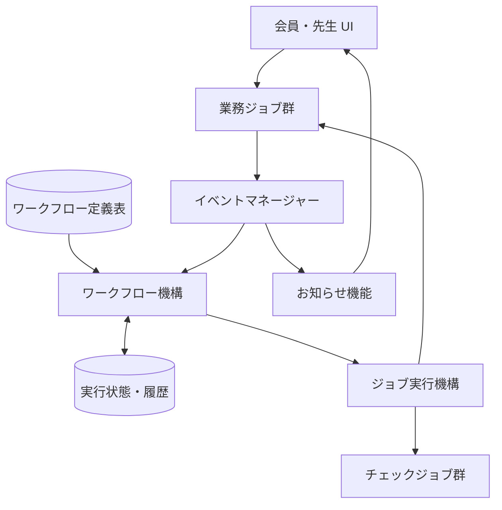
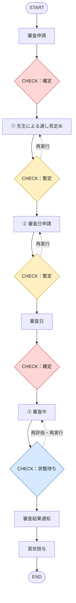
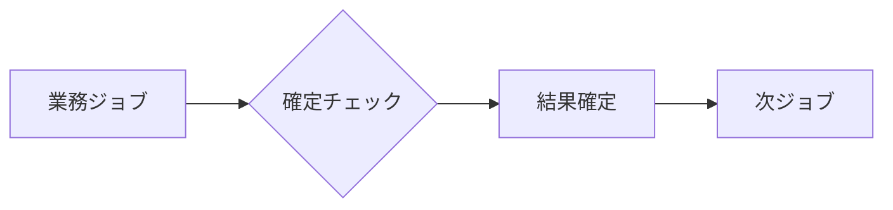
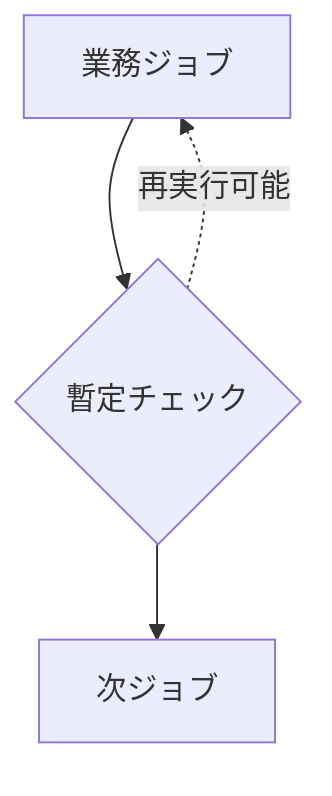
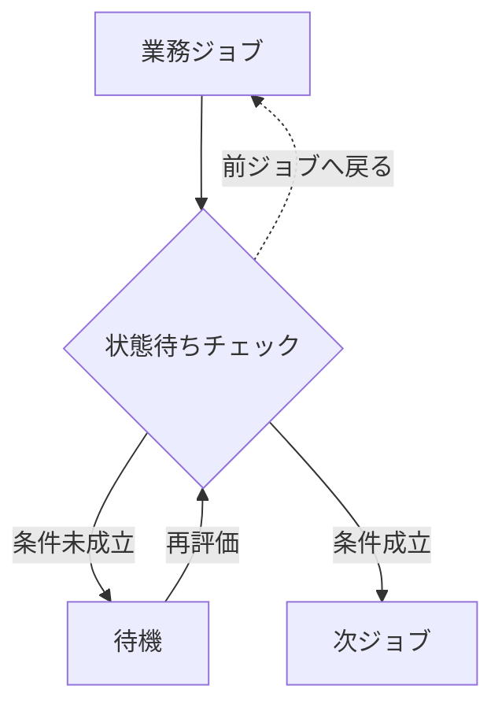
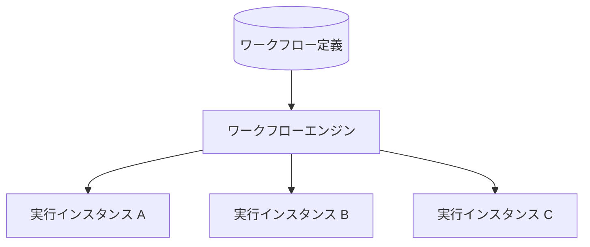
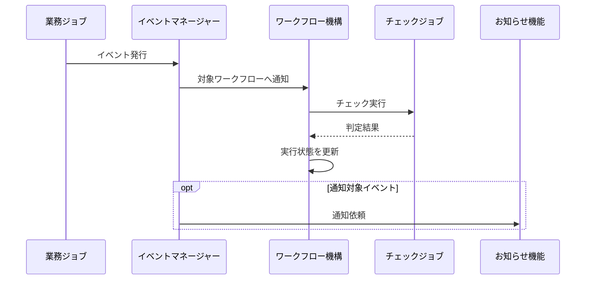
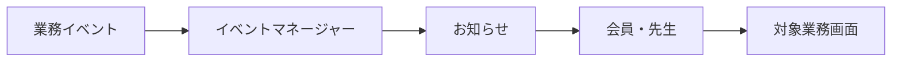
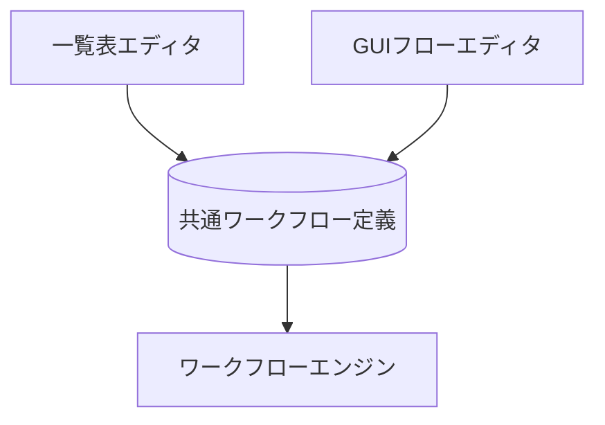

# ARCH-026 ワークフロー・イベント管理アーキテクチャ

* 文書ID：ARCH-026
* ファイル名：`ARCH-026_Workflow_Event_Architecture.md`
* ステータス：基本設計案
* 対象：桜風館 道場管理システム
* 適用範囲：ワークフロー管理、ジョブ実行、イベント管理、お知らせ連携

---

## 1. 目的

道場管理システムにおける複数の業務処理を、共通のワークフロー機構によって制御する。

対象業務の例：

* 審査申請・日程調整・審査結果管理
* 特別講習の案内・参加申請
* 会費未払いの確認・通知
* その他、複数工程から構成される業務

個別業務ごとに進行管理を実装するのではなく、共通のシーケンス機構とイベントマネージャーを利用する。

### 最上位設計原則

> **ワークフローは業務を知らない。**

ワークフロー機構は、業務内容を解釈しない。

業務処理は業務ジョブが担当し、ワークフロー機構は定義されたジョブの実行順序、チェック、遷移、待機、再実行を管理する。

---

## 2. 全体アーキテクチャ

### 責務分離

| 構成要素       | 責務               |
| ---------- | ---------------- |
| ワークフロー機構   | 定義表に従った進行制御      |
| ジョブ実行機構    | 指定されたジョブの呼び出し    |
| 業務ジョブ      | 個別の業務処理          |
| チェックジョブ    | 進行条件と確定・暫定・待機の判定 |
| イベントマネージャー | イベントの受信・配送       |
| お知らせ機能     | 利用者への情報伝達        |
| 実行管理       | 現在位置・状態・履歴の保持    |

※コンポーネント間の具体的なAPI・通信方式は別途設計する。

---

## 3. ワークフロー基本構造

ワークフローは、業務ジョブとチェックジョブの組み合わせで構成する。

ワークフローの実行順序は、一覧表で定義する。

### 3.1 審査申請ワークフロー

**凡例**

* 赤：確定チェック
* 黄：暫定チェック
* 青：状態待ちチェック
* 破線：戻り経路

この図は基本シーケンスを表す。戻り経路の実行条件は、チェックジョブの契約で定義する。

---

## 4. チェックジョブ

チェックジョブは3種類とする。

### 4.1 確定チェック

前工程の結果を確定する。

確定後、通常のワークフロー操作では前工程を再実行できない。

### 4.2 暫定チェック

前工程の結果を暫定として扱う。

暫定状態では、次工程へ進んだ後でも前工程を再実行できる。

例：先生による見定め、審査日申請。

### 4.3 状態待ちチェック

所定の状態になるまで待機する。

例：審査中から審査結果通知への移行。

状態待ち中に前ジョブを再実行する条件、およびイベントによる再評価方法は未決定とする。

---

## 5. ワークフロー定義表

ワークフローは、一覧表として定義できる構造とする。

### 5.1 定義例

| Step ID | 種別                | ジョブ        | 次ステップ | 戻り先  |
| ------- | ----------------- | ---------- | ----- | ---- |
| S001    | JOB               | 審査申請       | S002  | —    |
| S002    | CHECK_FINAL       | 確定         | S003  | —    |
| S003    | JOB               | 先生による通し見定め | S004  | —    |
| S004    | CHECK_PROVISIONAL | 暫定         | S005  | S003 |
| S005    | JOB               | 審査日申請      | S006  | —    |
| S006    | CHECK_PROVISIONAL | 暫定         | S007  | S005 |
| S007    | JOB               | 審査日        | S008  | —    |
| S008    | CHECK_FINAL       | 確定         | S009  | —    |
| S009    | JOB               | 審査中        | S010  | —    |
| S010    | CHECK_WAIT        | 状態待ち       | S011  | S009 |
| S011    | JOB               | 審査結果通知     | S012  | —    |
| S012    | JOB               | 賞状授与       | S013  | —    |
| S013    | END               | 終了         | —     | —    |

Step IDは、行の並び順とは独立した識別子とする。

### 5.2 定義と実行の分離

同じ定義から複数のワークフロー実行インスタンスを生成できる。

定義の変更が進行中のインスタンスに与える影響を制御するため、定義バージョンを管理する。

---

## 6. イベントマネージャー

イベントマネージャーは、業務処理などで発生したイベントを受け取り、必要な処理へ配送する。

イベントマネージャー自身は業務内容を判断しない。

### 6.1 イベント連携

イベントと対象ワークフロー・通知処理との対応は、別途定義する。

---

## 7. お知らせ機能

お知らせ機能は、利用者への情報伝達を担当する。

業務処理そのものは実行しない。

対象業務の例：

* 審査申請の受付
* 先生への審査申請通知
* 審査日程の連絡
* 審査日接近通知
* 審査結果通知
* 特別講習の案内
* 会費未払い通知

通知の閲覧と、申請・回答・結果管理は分離する。

---

## 8. 実行状態と履歴

ワークフロー定義と実行状態は別管理とする。

実行管理では、少なくとも次を識別できる必要がある。

* ワークフロー実行ID
* 使用する定義ID・バージョン
* 現在のステップ
* 実行状態
* ジョブの実行履歴
* チェック結果
* 再実行履歴

暫定チェックによる再実行では、過去の実行履歴を消去せず、実行の経緯を追跡できるようにする。

---

## 9. 将来のGUI編集

当初は一覧表によってワークフローを定義する。

将来的には、GUIによる編集を可能にする。

GUIと一覧表は、同じ定義構造を使用する。

ワークフローエンジンは、定義の作成方法を区別しない。

---

## 10. 既存アーキテクチャとの関係

既存の業務ディスパッチ、DAO/DTO、Firebase移行方針との整合性を維持する。

ワークフロー機構は、業務処理の実装方式やデータ保存方式を直接認識しない。

業務処理は既存の業務境界を通して実行する。

ワークフロー導入を理由として、業務別のAPIを大量に追加しない。

本設計は共通基盤の構想であり、既存業務を直ちに置き換えるものではない。

---

## 11. 未決定事項

以下は今後の詳細設計で決定する。

1. 各チェックジョブの具体的な入出力契約
2. 暫定ジョブ再実行時の後続ジョブの扱い
3. 状態待ちチェックの再評価・前ジョブ再実行条件
4. 確定済みジョブの例外的な訂正手続き
5. イベントの購読・配送・再送・重複防止
6. ワークフロー実行の排他制御
7. 定義バージョンの切り替え方法
8. ジョブ実行失敗時の復旧方法
9. お知らせの配信先・既読管理・通知経路
10. GUI編集機能の実装時期

---

## 12. 設計方針のまとめ

本アーキテクチャは、次の構成を基本とする。

**業務ジョブ：何をするか**

**チェックジョブ：確定・暫定・待機をどう扱うか**

**ワークフロー定義：どの順序で実行するか**

**ワークフロー機構：定義に従って実行を管理する**

**イベントマネージャー：発生したイベントを必要な処理へ伝える**

**お知らせ機能：利用者へ情報を伝える**

これらの責務を分離し、業務に依存しない共通基盤として構築する。
