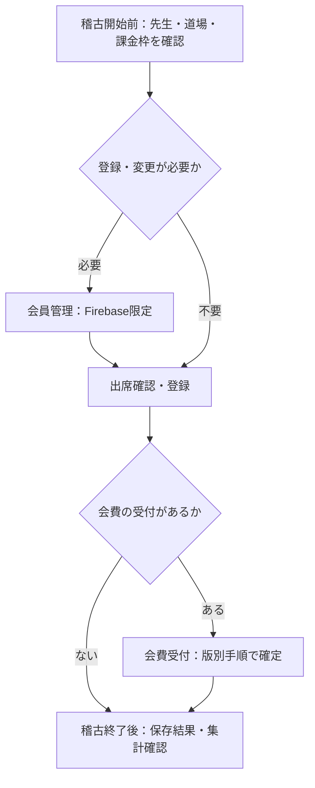

# 桜風館 先生向け操作マニュアル

## 桜風館｜先生向け操作マニュアル

確認版 v0.1 / 2026年10月19日
日常の稽古受付を中心にまとめた、開発・デモ段階の資料です。
基準：ZIP（124）の docs/manual/teacher/TEACHER_OPERATION_SPEC.md（2026年10月19日）。ボタン名は同梱ソースで確認しました。
先生ホームの実画面は未ログイン状態で確認できましたが、画像取得がタイムアウトしました。画像欄は仮置きです。認証後の画面・保存完了表示は実機未確認です。

使い方
「タップ」は、画面を指で軽く1回押すことです。下の項目が見えないときは、指で画面を上になぞって下へ進みます。
操作番号①②③の順に進め、最後に「完了の確認」を行ってください。入力例は架空のものです。実際の受付には使わないでください。

目次
2 運用フロー / 3 入場と先生ホーム / 4 本日の出席
5 現金受付 / 6 PayPay反映 / 7 会員登録・編集
8 支払いグループ・退会 / 9 QR作成 / 10 稽古終了後
11 困ったとき / 12 GAS版の補足と版別一覧

対象外
審査管理・決済コード確認は試作です。月次処理・お知らせは準備中です。通常業務の手順には含めません。
正式な認証方式・運用ルールは今後の協議事項です。ここでは現行画面の操作を説明します。

## 1日の運用フロー

稽古開始前：先生QRから入場し、先生・道場・当日の課金枠を確認します。
出席確認：会員QRを読み、稽古枠・現在級段位を確認して出席を登録します。
会費受付：対象会員・対象月・未払い額を確認し、現金またはPayPayの手順へ進みます。
会員登録・変更：必要な場合だけ会員管理へ進みます（Firebase限定）。
稽古終了後：出席の保存結果と会費集計を確認します。終了専用の締め処理は仕様書にありません。

受付で迷ったとき
道場・先生・課金枠が不明なまま進めず、担当者に確認してください。
会員登録直後に、会費が受付可能になるとは限りません。支払いグループの保存だけでは、月次プラン・請求は作られません。

## 入場する・先生ホームを開く

① 案内された入口画面を開き、「QR読み取り開始」を押します。
② 配布された先生QRを読み取ります。すでに先生の情報が表示されている場合は、本人の先生IDを確かめて「続ける」を押します。
③ 先生ホームで、自分の先生IDを確認します。道場情報が引き継がれているか、移動先でも確認してください。
④ 「本日の出席」「会費受付」など、必要なメニューを押します。

完了の確認
先生ホームに自分の先生IDが表示され、業務画面へ進めます。「未ログイン」の場合は入場をやり直してください。

Firebase版の追加ログイン
会費受付・本日の出席・会員管理・QR生成では、現行の管理者権限でのログインが必要です。各画面のログイン案内に従い、許可された管理者アカウントを使用します。会費受付・QR生成は「管理者としてGoogleログイン」、会員管理は「管理者ログイン」です。
先生QRによる入場だけでは、この管理者ログインは完了しません。

終了・移動
「入口へ戻る」は画面移動です。「ログアウト」は先生QRのセッションを消して入口へ戻ります。Googleアカウントからのログアウトとは別です。

> 実画面画像：確認待ち｜入口／先生ホーム：先生ID・メニュー・ログアウト

## 本日の出席を登録する

① 先生ホームの「本日の出席」を開きます。Firebase版では管理者ログインを確認します。
② 道場・先生・当日の課金枠を確認し、課金枠候補から対象を選びます。
③ 「読み取り開始」を押し、会員QRを読み取ります。読み取りを終えたら「停止」を押します。
④ 会員ごとに、出席する稽古枠と現在級段位を確認します。Firebase版で会費タイプが求められた場合は、該当する選択肢を選びます。
⑤ 「選択した出席を登録」を1回押し、結果が出るまで待ちます。

選択例（架空）
会員「桜井 太郎」が当日の対象枠に参加する場合、その枠だけを選びます。現在級段位は本人の記録と一致する選択肢にします。

完了の確認
保存後に取得された本日の出席者一覧で、会員と稽古枠を確認します。Firebase版は送信内容と保存結果を照合します。エラーが表示された場合は完了扱いにしません。

出席の訂正
登録済み状態を確認してから、対象枠を選択・解除して再登録します。解除は取消履歴を残します。級段位の変更も会員情報に反映されます。
「会員一覧をクリア」は登録候補の一覧を消す操作です。保存済み出席の取消操作として使わないでください。

> 実画面画像：確認待ち｜本日の出席：対象枠・会員候補・登録ボタン・保存後一覧

## 現金を受け付ける

共通の準備
① 「会費受付」を開き、先生・道場・課金枠・業務日を確認します。
② 「読み取り開始」で会員QRを読み取ります。会員名・請求グループ・対象月・未払い額を確認します。
③ 表示額の現金を受け取り、金額を確かめます。
例：表示された未払い額が3,000円なら、受け取った3,000円と照合します。任意の金額を入力する手順ではありません。

Firebase版：1件ごとに確定
④ 「現金受領」を1回押し、処理が終わるまで待ちます。この操作で入金が即時確定します。
⑤ 「現金受領を確定し、表示を更新しました。」と操作ログの会員ID・受領額を確認します。最新の会員情報と本日の集計も確認します。
「確定しましたが、最新表示の取得に失敗」と出た場合は、再度受領せず「登録済みを再取得」で確認します。

GAS版：最後にまとめて送信
④ 「現金受領」で画面内の未送信リストへ追加します。必要な会員の受付を続けます。
⑤ 未送信リストと合計を照合し、「集金完了」を押します。誤った未送信項目は個別削除できます。
⑥ 送信完了後に再取得される登録済み集計・一覧を確認します。「現金受領」だけでは保存完了ではありません。

未払い0円・請求未作成などで停止した場合は、無理に受領を進めず担当者に確認します。

> 実画面画像：確認待ち｜会費受付：会員情報・現金受領・本日の集計／GAS未送信リスト

## PayPayを入金へ反映する

この操作は、確認済みの決済証跡を入金へ反映するものです。先生画面からPayPay送金を行う手順ではありません。

① 「会費受付」で受付範囲を確認し、「決済情報取得」を押します。
② CONFIRMED（確認済み・入金反映前）の一覧を確認します。会員・対象・金額など、画面の情報を照合します。
③ 入金へ反映する証跡を選択します。「全選択」は全件を確認できた場合だけ使用します。
④ 「選択分を決済更新」を1回押し、結果を待ちます。
⑤ Firebase版では操作ログの「PayPay決済更新完了」と反映件数を確認します。POSTED（入金反映済み）一覧と受付集計でも確認します。GAS版も処理後の一覧と集計で確認します。

照合例（架空）
反映対象が1件なら、選択した会員と金額が正しいことを確認して更新します。完了件数が1件で、POSTED側と集計に反映されたことを確かめます。

迷いやすい点
先生ホームの「決済コード確認」は試作で、入金へ反映されません。通常受付には使用しません。
CONFIRMEDに見つからない場合は、POSTED側も確認します。同じ支払いを新しい現金受付として登録し直さないでください。

> 実画面画像：確認待ち｜会費受付：CONFIRMED・選択分を決済更新・POSTED・完了ログ

## 会員を検索・登録・編集する

Firebase限定。先生ホームの「会員管理」を開き、管理者ログインを確認します。

検索・編集
① 「会員ID・氏名・ふりがなで検索」へ入力します。例：「さくらい」。
② 該当する会員を確認し、「編集」を押します。同姓同名の場合は会員IDで照合します。
③ 必要な項目を変更し、「保存」を押します。既存の会員IDは編集できません。

新規登録
① 「新規登録」を押します。
② 必須の会員ID・氏名・会員区分・入会日を入力します。会員IDは道場で決めた未使用の値を使い、会員区分は既存の区分を確認します。
入力例（架空）：氏名「桜井 太郎」、ふりがな「さくらい たろう」、入会日「2026-10-19」。会員ID・会員区分の採番・名称ルールは本仕様書にないため、担当者に確認します。
③ 必要に応じて、生年月日、保険区分、メール、電話、現在級段位、備考などを入力し、「保存」を押します。

完了の確認
「会員情報を保存しました。」を確認し、更新された一覧で登録・変更内容を確かめます。
新規会員には未使用の支払いグループが初期設定されますが、登録だけで月次プランや請求は作成されません。
GAS版の会員管理は利用できません。

> 実画面画像：確認待ち｜会員管理：検索欄・新規登録・編集フォーム・保存完了

## 支払いグループを変更する・退会

Firebase限定。日常受付とは別に、内容を確認して行う操作です。

支払いグループ編成
① 会員一覧の対象会員から「支払設定」を押します。
② 編成先（新しいグループ、または既存グループ）を選びます。
③ グループへ入れる会員を1～5人選び、共通の会費タイプと料金プラン候補を確認します。
④ 「グループ編成を保存」を押します。
完了：「支払いグループを保存しました。料金プランは月次会費管理で確定してください。」と一覧の更新を確認します。
例：家族2人をまとめる場合は、対象の2人を会員IDで確認して選びます。
この操作だけでは月次料金プラン・請求を確定しません。先生ホームの「月次処理」は準備中なので、そのボタンへ進む案内はできません。確定方法は担当者に確認します。

退会手続き
① 「退会手続き（会員ID指定）」に対象会員IDを入力し、「会員を確認」を押します。
② 本人であることを確認し、退会日を入力します。例：「2026-10-31」。
③ 「退会を確定」を押し、確認ダイアログの内容を読み、正しければ同意します。
完了：「退会手続きを保存しました。」を確認し、一覧で状態と退会日を確かめます。
退会処理は過去の請求・入金履歴を変更しません。

> 実画面画像：確認待ち｜会員管理：支払設定／グループ編成／退会確認

## QRを作成・印刷する

① 先生ホームの「QR生成」を開きます。Firebase版は管理者ログイン、GAS版は先生QRによる入場が必要です。
② 種類を選び、対象を選択します。
・会員カード：会員を選択
・月謝／都度支払い：会員と対応する料金プランを選択
・道場：道場を選択
・先生＋道場：先生と道場を選択
③ 「プレビューへ」を押し、表示された対象とQRを確認します。
④ 「選択中のQRを追加」を押して印刷リストへ入れます。複数枚必要な場合は同じQRを追加できます。
⑤ リストを確認し、「B5 PDF／印刷」を押します。不要な項目は「削除」、全件消すときは「全件クリア」を使います。
⑥ ブラウザの印刷画面でB5横向きの配置を確認して印刷します。PDFに保存する場合は、端末で利用できるPDF保存先を選びます。

例
会員カードを1枚作る場合：「会員カード」→対象会員→「プレビューへ」→「選択中のQRを追加」→「B5 PDF／印刷」。

完了の確認
印刷プレビューと出力した用紙で、対象の名前と必要な枚数を確認します。8枚ごとのページ配置です。
印刷リストは画面内だけに保持されます。再読込後の復元はできません。「B5 PDF／印刷」はサーバーがPDFを作る機能ではありません。

> 実画面画像：確認待ち｜QR生成：種別・対象選択・プレビュー・印刷リスト・印刷画面

## 稽古終了後に確認する

① 「本日の出席」で保存後の一覧を確認します。
会員と参加枠が実際の参加状況と合っているか確認します。送信前の候補一覧に残っているだけのものは、登録済みと考えないでください。

② 「会費受付」の「登録済みを再取得」で本日の集計を確認します。
現金・PayPay・合計・入金件数・未回収予定額・出席人数を確認します。未回収予定額や要確認情報がある場合は、内容を確認して引き継ぎます。

③ GAS版では、未送信の現金受付が残っていないか確認します。
残っている場合は内容を照合し、「集金完了」で送信して完了を確認します。送信前に画面を閉じたり再読込したりしないでください。

④ 必要な確認が終わったら先生ホームへ戻ります。
先生QRの情報を消して終える場合は「ログアウト」を押します。「入口へ戻る」だけではログアウトになりません。

このマニュアルで扱う終了後確認は、既存画面を用いた確認手順です。日次締め・現金精算・引継ぎ先などの正式な運用ルールは別途協議してください。

## 困ったとき

ログインできない
先生ホームが「未ログイン」なら入口へ戻り、配布された先生QRで入り直します。Firebaseのログイン要求がある場合は、許可された管理者アカウントを使用します。401はログイン状態、403は権限を担当者に確認します。先生IDが表示されているだけでは管理者認証完了ではありません。

会員が見つからない
QRが本人のものか確認します。Firebase版の会員管理では検索文字を短くする、会員IDで検索する、検索を消して「再読込」を試します。なお見つからなければ登録状況を担当者に確認し、重複登録を避けます。

会費が反映されない
Firebase現金は操作ログと「登録済みを再取得」で確認します。GAS現金は未送信リストと「集金完了」の送信結果を確認します。PayPayは「決済情報取得」でCONFIRMEDとPOSTED、完了件数・集計を確認します。未払い0円・請求未作成・月次選択未登録・プラン不一致は受付が停止するため、担当者に確認します。

通信エラーが出た
表示された文言、時刻、対象会員ID、操作内容を控えます。通信状態を確認し、取得だけの操作なら「更新」「再読込」「登録済みを再取得」を使います。
現金受領の結果不明は、入金失敗とは限りません。Firebase版で「同じ会員の現金受領を再試行」と表示された場合は、画面を保ったまま同じ受付を再試行します。同じ要求として扱うため、先に画面クリア・再読込・新しい受付を行わないでください。
出席・GAS送信などで保存結果が不明な場合も、保存済み状態を確認してから判断します。判断できない場合はエラー情報を担当者へ渡します。

## GAS版の補足・利用できる範囲

先生出席（GAS限定）
① 「先生出席」を開き、先生を確認します。必要なら先生QR、または先生に紐づく会員QRを読みます。
② 道場QR・課金枠QRを読み、主先生／副先生と対象稽古枠を選択します。
③ 登録済み状態を確認して保存操作を行います。保存ボタン名・位置は実画面確認待ちです。
完了：「先生出席を登録しました。」と登録状態・当月の主／副／合計回数を確認します。給与の単価・金額は扱いません。

会費状況（GAS限定・参照のみ）
① 「会費状況」を開き、入金日の開始日・終了日、会員別状況の対象月を指定します。
② 「表示を更新」を押します。例：2026-10-01～2026-10-31、対象月2026年10月。
③ 集計・請求グループ別の未払い額・入金明細を確認します。ここで保存・入金更新は行いません。

版別一覧
両版：先生QR入場、本日の出席、会費受付、QR生成。
Firebase限定：会員管理。
GAS限定：先生出席、会費状況。Firebase Hostingから開いても正常動作は保証されません。
両版とも試作：審査管理、決済コード確認。業務データの保存なし。
両版とも準備中：月次処理、お知らせ。

改訂用メモ
基準資料は現行実装の調査結果です。次回は各画面の実画像、認証後表示、保存完了表示を確認して差し替えます。開発用の識別子や実在の個人情報を配布画像へ含めないよう確認してください。

> 実画面画像：確認待ち｜GAS先生出席／会費状況：条件・保存操作・更新結果
