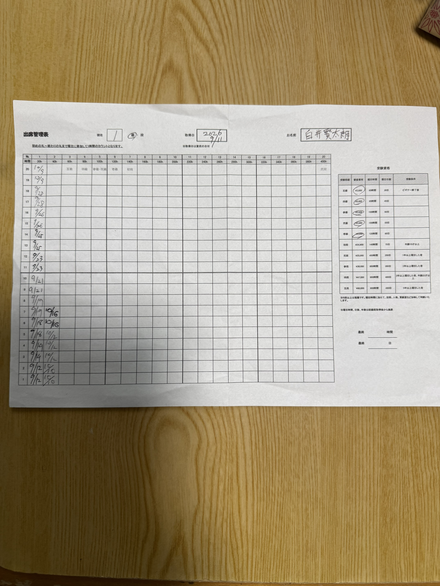
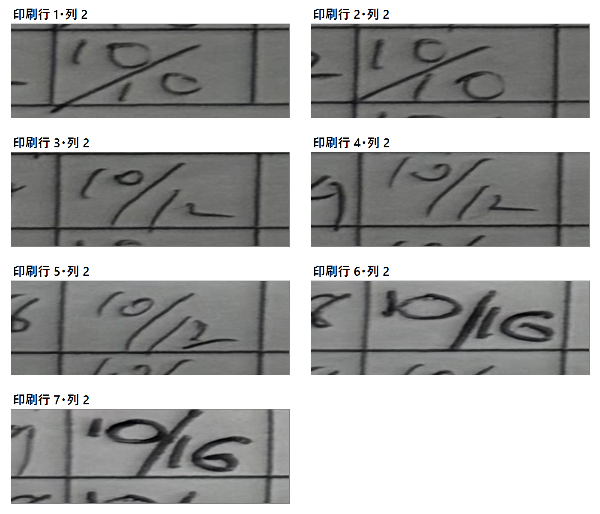

# 紙の出席記録 Gemini検証用画像

## 第1～4回：元帳票画像

- ファイル: `paper-attendance-source-20261019.jpg`
- 用途: 帳票全体を使用した第1～4回のGemini解析
- サイズ: 4,284 × 5,712 px
- ファイルサイズ: 3,884,233 bytes
- SHA-256: `EAC1E2E4ABD63688937EADD3DDFAA3FC559048E6684358753BAD08F65E501E00`
- 備考: iCloud Drive上の原本を内容変更せずコピーした。原本とコピーのSHA-256は一致している。

## 第5回：第2列下部7セル拡大画像

- ファイル: `paper-attendance-round5-column2-rows1-7-crops.png`
- 用途: 印刷行1～7・列2の再認識
- 生成方法: 元帳票から各セルを周辺余白付きで切り出し、拡大配置
- 画像処理: 二値化、罫線除去、文字補完なし
- 備考: 各切り出しの上に印刷行番号と列番号を表示している。

## 保存場所

両画像と第1～5回のJSON・Markdown・実験スクリプトは、同じ`work`フォルダに保存している。

